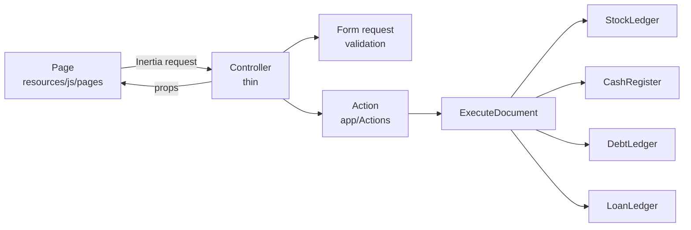
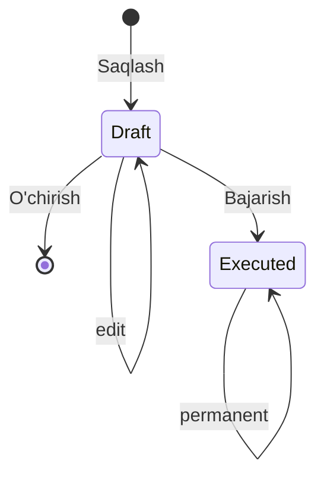

# Architecture

How the mini-ERP is built, and why. Read this before the code.

**In one line:** controllers are thin, all rules live in `app/Actions`, and only five modules may change stock, cost, cash or debt.

The brief: [Texnik topshiriq: Ichimliklar do'koni uchun mini-ERP](https://telegra.ph/Texnik-topshiriq-Ichimliklar-dokoni-uchun-mini-ERP-10-20).

## Start here

| If you want to… | Open |
| --- | --- |
| know what a word means (piece, block, draft, executed…) | [`GLOSSARY.md`](../GLOSSARY.md) |
| see a hard decision and its reason | [`docs/adr/`](adr/) (table [at the end](#decision-records)) |
| see the app from the user's side, with screenshots | [`docs/user-guide.md`](user-guide.md) |
| see how competitors do it | [`research/uzbek-pos-erp-competitors.md`](research/uzbek-pos-erp-competitors.md) |
| see the UX baseline (sale screen, drafts, sidebar) | [`research/ux-flows.md`](research/ux-flows.md) |

---

## 1. The problem

A drinks shop in Uzbekistan:

- sells by the **piece** and by the **block**, often on debt to small shops;
- buys on debt from suppliers;
- needs to know stock per place, who owes whom, cash per payment method, and real profit;
- has employees who must sell fast **without** seeing purchase prices or profit.

Every choice below serves one of three goals:

1. **Numbers the owner can trust**
2. **Separation** between stores and between roles
3. **Speed** at the counter

---

## 2. Stack

| Layer | Choice |
| --- | --- |
| Backend | Laravel 13, PHP 8.5, Fortify (login) |
| Frontend | Inertia v3 + React + TypeScript, Tailwind, shadcn-style components |
| Routes in TS | Wayfinder (`resources/js/routes`, `resources/js/actions`) |
| Roles | spatie/laravel-permission, teams mode |
| Database | SQLite by default; locks and queries also correct on MySQL and PostgreSQL |
| Tests | Pest, PHPStan, Pint |

Started from the Laravel React starter kit. Kept: shell, sidebar, settings, 2FA, passkeys. Removed: personal teams, invitations, email login (ADR-0003).

---

## 3. How a request flows



- A controller does three things: validate (form request), call **one** action, render a page.
- **Only** these five modules write stock, cost, cash or debt rows: `ExecuteDocument`, `StockLedger`, `CashRegister`, `DebtLedger`, `LoanLedger`.

### Code map

```
app/
  Actions/
    Documents/   ExecuteDocument, StockLedger, SaveDraft, PreviousPrices,
                 ReturnedQuantities, PendingDrafts
    Cash/        CashRegister, DebtLedger, LoanLedger
    Reports/     ProfitAndLoss, CashFlow, BalanceSheet, SalesReport, StockReport
    Stores/      CreateStore, CreateEmployee
  Concerns/      BelongsToStore (tenancy), shared validation rules
  Enums/         DocumentKind, DocumentStatus, CashOperationType, StockLevel,
                 PaymentMethod, StorePermission, StoreRole, …
  Http/          thin controllers, form requests, middleware
  Models/        Eloquent models + Scopes/StoreScope
  Support/       Money, Quantity, Phone, StoreTeamResolver
resources/js/
  pages/         one folder per screen
  components/    document-form, list-page, money-input, nav-main, …
  lib/navigation.ts   the one sidebar, filtered by permission
```

---

## 4. Tenancy: one database, many stores

**Rule:** every business table has `team_id`. The starter kit's `Team` **is** the store. ([ADR-0003](adr/0003-team-is-the-store.md))

How it's enforced:

| Layer | What it does |
| --- | --- |
| `BelongsToStore` trait | adds `StoreScope`: every query is filtered to the signed-in user's `team_id`. Also stamps `team_id` on create. |
| No store = no rows | a user without a store (super-admin) matches nothing (`1 = 0`) |
| `store` middleware | 403 on every store route for a user with no store |
| `ExecuteDocument` | bypasses scopes to lock rows, so it re-checks `user.team_id === document.team_id` itself |
| Test | `tests/Feature/StoreIsolationTest.php`: store A can't see or change store B |

**Why:** a database per store is costly for small shops. Reusing Team gave membership and team-aware permissions for free. An employee never works in two stores, so team switching and invitations were removed.

---

## 5. Login, roles, permissions

### Login

- **Phone + password**, not email. Shop staff often have no email.
- Phone stored as `+998XXXXXXXXX`, unique, typed in the mask `+998 __ ___ __ __` (`app/Support/Phone.php`).
- Forgot password? The owner resets an employee's. The super-admin resets an owner's.
- 2FA and passkeys: optional.

### Blocking

- A user can be deactivated. A store can be blocked.
- `EnsureAccountIsActive` runs on every request and logs such users out with the reason (`Do'kon bloklangan.`).
- Nothing is deleted.

### Roles

| Role | Scope | Created by |
| --- | --- | --- |
| `owner` | one store | sign-up |
| `employee` | one store | the owner |
| `super-admin` | global | only `php artisan app:create-super-admin` |

### Permissions, not role checks

`StorePermission` (`app/Enums/StorePermission.php`) lists fine-grained permissions: `sale.execute`, `purchase.draft`, `costs.view`, `finance-reports.view`… The owner gets all; the employee a fixed subset.

The **same names** are checked in four places:

1. routes (`can:…` in `routes/web.php`)
2. policies and `ExecuteDocument` (`DocumentKind::executePermission()`)
3. controllers, which **leave cost fields out of page props** without `costs.view` (average cost, purchase prices, stock value, profit)
4. the sidebar (`resources/js/lib/navigation.ts`)

**Why:** the menu and the server can't drift apart. A typed URL is refused too.

### What an employee can do

| Area | Employee |
| --- | --- |
| Sale, transfer | draft and execute |
| Purchase, inventory count, sales return | draft only; the owner executes |
| Supplier return, opening balance, loans, debt write-off, supplier payments | no access |
| Purchase prices, average cost, stock value, profit, finance reports, cash balance | hidden on the server |
| Expense categories | all except _Egasi olgan pul_, _Qarz foizi_, _Umidsiz qarz_ |
| Products, counterparties | view; quick-create counterparties inside a document |

---

## 6. Documents

Every movement of goods is a **document**. Seven kinds:

| Kind | Uzbek |
| --- | --- |
| Sale | Sotuv |
| Sales return | Vozvrat |
| Purchase | Xarid |
| Supplier return | Postavshikka vozvrat |
| Transfer | Transfer |
| Inventory count | Inventarizatsiya |
| Opening balance | Boshlang'ich qoldiq |

### Two states



- **Draft** (_Qoralama_): changes nothing. Editable, deletable.
- **Executed** (_Bajarilgan_): effects applied. Permanent.

### One table for all kinds

All kinds share `documents` and `document_lines`. Why:

- same lifecycle, numbering (`Sotuv №123`), author, executor and list page;
- a return links to its source line in the same table, so "sold − returned" is one query (`ReturnedQuantities`);
- the owner's inbox (`PendingDrafts`) is one query.

Kind-specific data sits in nullable columns (destination for transfers, refund method for returns, expected quantity for counts). The opening balance adds child tables: `document_payments`, `opening_debts`, `opening_loans`.

### Quantities

- Stock is whole **pieces** (_dona_).
- **Blocks** (_blok_) are for typing and display only (`app/Support/Quantity.php`).
- Each line snapshots the product's pieces per block, so old documents still read right after a product is edited.

### Executed = permanent ([ADR-0006](adr/0006-executed-documents-are-permanent.md))

No edit, delete, cancel or un-execute. Fix a mistake with the opposite document:

| Mistake | Fix |
| --- | --- |
| sale | sales return |
| purchase | supplier return |
| transfer | reverse transfer (**Teskari transfer** pre-fills it) |
| count | a new count |

- **The date is the moment of execution.** No backdating.
- So a late purchase can never change the cost, and the profit, of sales already made.

### Prices ([ADR-0007](adr/0007-optional-product-sale-price.md), supersedes [ADR-0004](adr/0004-no-stored-sale-price.md))

All prices are **per piece**. The UI also shows the block price ("1 blok = 78 000 so'm").

A new **sale** line pre-fills from, in order:

1. the product's optional **sale price** (_Sotuv narxi_)
2. else the **previous price**: the last executed sale of that product (`PreviousPrices`)
3. else empty and required

A new **purchase** line uses the previous purchase price only.

Safety net: users with `costs.view` see the average cost on sale lines and the warning _Narx o'rtacha tannarxdan past_ when the price is below it.

---

## 7. ExecuteDocument: the only way a document takes effect

`app/Actions/Documents/ExecuteDocument.php`, one call: `handle(Document, User)`, inside **one transaction**:

1. **Lock the document.** Check: still a draft, user has the execute permission, same store.
2. **Lock the store.** Check the **opening-balance gate**: nothing executes until the opening balance is executed or skipped.
3. **Lock cost rows, then stock rows, in id order.** Fixed order = two executions wait instead of deadlocking.
4. **Validate the kind:** stock covers outgoing lines, prices present, return ≤ returnable, payments ≤ total, customer present if part is unpaid, from ≠ to, no cash-out above the balance.
5. **Apply effects** through the ledgers. Then stamp status, executor, `executed_at`.

Any failure throws a `ValidationException` keyed like the form (`lines.3.pieces`, `payments.cash`) with an Uzbek message, e.g. _Joyda yetarli emas. Qoldiq: 2 blok + 4 dona._ The transaction rolls back: **all or nothing**.

### What each kind does

| Kind | Stock | Average cost | Money and debt |
| --- | --- | --- | --- |
| Opening balance | in | blends at entered cost | opening cash, debts, loans. Never in P&L |
| Purchase | in | blends at purchase price | paid part out of the register; rest = supplier debt |
| Sale | out | unchanged; line stores current average as `unit_cost` | paid part in; rest = customer debt (customer required) |
| Sales return | in | blends at the sale line's stored cost | customer debt first, rest refunded |
| Supplier return | out | removes pieces at purchase price | supplier debt first, rest back into the register |
| Transfer | out of one place, into another | unchanged | none |
| Inventory count | set to counted | unchanged | difference × average cost = shortage or surplus in P&L |

### Why one module

The rules (no negative stock, no negative cash, returns within limits, stable costs) cut across stock, cost, cash and debt. One entry point = every screen gets the same checks and locks. Tests call it directly (`tests/Feature/Documents/Execute*Test.php`).

### Two people, last bottle

Every check reads a row it already locked with `lockForUpdate()`. The second execution waits, then sees the first one's result. SQLite serialises writes anyway; the code doesn't rely on that.

---

## 8. Stock and average cost

### Stock

- `stock_balances`: current pieces per (store, location, product).
- `stock_movements`: append-only history, linked to document lines.
- A balance never goes negative. Asking for more throws `InsufficientStock` with what's there.
- Stock levels for the Qoldiqlar tabs (`app/Enums/StockLevel.php`): 0 = _Tugagan_, 1–10 = _Kam_, 11–50 = _O'rtacha_, above 50 = _Yetarli_.

### Average cost ([ADR-0002](adr/0002-moving-average-cost.md))

Stored per (store, product) in `product_costs`, across all locations. 6 decimals (money has 2).

| Event | Formula |
| --- | --- |
| In at a known cost (purchase, opening balance, sales return) | `(on hand × avg + qty × cost) / (on hand + qty)` |
| Out (sale, transfer, shortage) | unchanged; the sale line stores it as `unit_cost` |
| Supplier return | `(on hand × avg − qty × price) / (on hand − qty)`; stays put if on hand hits 0 |
| Surplus | enters at current average, so no change |

**Why not FIFO:** FIFO needs batches and re-costing. Moving average needs one row per product and is easy to explain ("what one bottle cost us, on average"). NSBU 4 allows both.

---

## 9. Money

All money: `DECIMAL(18,2)` in the database, `bcmath` strings in PHP. Never floats. UZS only.

### Cash register (`app/Actions/Cash/CashRegister.php`)

The **only** way money enters or leaves a store.

- Each operation has a **type** (sale payment, expense, loan given, …) that fixes the direction, and a **method**: _Naqd_, _Karta_, _Bank o'tkazmasi_.
- `cash_balances`: one row per (store, method), locked before each move.
- **Cash-out above the balance is refused**, e.g. _Kassada naqd yetarli emas_.
- **Append-only.** Fix a mistake with **Tuzatish**: records the opposite once. A reversal can't be reversed.
- No shifts or Z-reports. Every operation records its author instead.

### Debts (`DebtLedger`)

- Append-only `debt_entries` per counterparty and side (customer or supplier).
- **Balance = sum of entries**, so it can always be explained line by line.
- A customer has **one balance**. The card shows which sales are unpaid by paying off the **oldest sale first** (`allocation()`).
- A payment can't exceed the debt. The counterparty row is locked.
- **Write-off** (owner only): lowers the debt, records _Umidsiz qarz_ expense, no money moves.
- Customers, suppliers and loan parties share one **counterparty** list.
- **Accrual:** a sale counts as revenue when executed, debt part included. Collecting it later is cash, not income.

### Loans (`LoanLedger`)

- A loan: counterparty, given or received, principal, optional due date.
- Opening it moves the principal through the register. Repayments are capped at the outstanding balance.
- Interest is recorded from the loan card: _Qarz foizi_ (expense) or _Olingan foiz_ (income).

**Loans stay out of net profit** ([ADR-0001](adr/0001-loans-stay-out-of-net-profit.md)). Borrowed money isn't income and lent money isn't an expense (NSBU 21, Tax Code art. 304). Only interest enters P&L. Loans still show next to net profit in **Foyda va zarar** and in **Balans**.

### Expense categories ([ADR-0005](adr/0005-fixed-expense-categories.md))

Fixed, global, seeded. Not editable per store.

| Category | In net profit | Employee may use |
| --- | --- | --- |
| Transport xarajati, Ijara, Ish haqi, Kommunal, Soliq | yes | yes |
| Boshqa (note required) | yes | yes |
| Qarz foizi | yes | no |
| Egasi olgan pul (owner withdrawal) | **no** | no |
| Umidsiz qarz (write-offs only) | yes | no |
| Olingan foiz (income) | yes | no |

**Why:** one kind of business, comparable P&L across stores, and owner withdrawals can't pose as costs.

---

## 10. Reports are read-only

Each report is a query module in `app/Actions/Reports`: store + filters in, plain arrays out. Reports never write.

| Report | Module | Shows |
| --- | --- | --- |
| Qoldiqlar | `StockReport` | pieces first, blocks under; level tabs; warehouse includes its sub-warehouses; value at average cost for `costs.view` |
| Sotuvlar | `SalesReport` | revenue net of returns, by product, by employee, paid vs debt; cost and gross profit for `costs.view` only |
| Foyda va zarar | `ProfitAndLoss` | `revenue − COGS = gross profit − expenses − shortages + surpluses ± interest = net profit` |
| Pul oqimi | `CashFlow` | every cash operation by type, category and day; a day links to Kassa filtered to it |
| Balans | `BalanceSheet` | cash per method, loans outstanding, customer and supplier debt |

Never in P&L: supplier payments, debt payments, loan principal, _Egasi olgan pul_, opening balance.

Dates use the store timezone, `Asia/Tashkent`.

---

## 11. Frontend

- **Uzbek UI, English code.** Screens and messages in Uzbek Latin (`APP_LOCALE=uz`). Code, database and docs in English.
- **Formats:** money `1 250 000 so'm`; quantities `60 dona` with `10 blok` under; prices `13 000 so'm / dona`.
- **Desktop only.** Counter PC or laptop.
- **One sidebar**, filtered by permission. Groups fold open independently. Owners see count badges on Xaridlar, Vozvratlar and Inventarizatsiya while drafts wait.
- **Two document UIs:**
  - **Sale screen**: cursor in the search box, scan or Enter = +1 dona, product tiles, receipt-style cart, parked sales as tabs, F2 saves, F9 executes.
  - **`document-form`** for every other kind: header, lines, totals, **Saqlash / Bajarish / O'chirish / Bekor qilish**. **Bajarish** always asks to confirm.
- **Shared inputs:** `ProductSearch` (lists every product when empty, arrow keys, scanner Enter) and `MoneyInput` (groups thousands, accepts only valid amounts).
- **One list pattern** (`list-page`): tabs, filters, search, empty states, _Filtrni tozalash_.

---

## 12. Testing

Tests check behaviour from outside: HTTP status, Inertia props, database rows, report numbers. No private methods.

| Seam | Covers |
| --- | --- |
| HTTP feature tests (as owner, employee, super-admin, guest) | sign-up, phone login, blocked stores, permissions (`PermissionsTest`), store isolation, every document flow, cost fields hidden from employees |
| Domain tests (`tests/Feature/Documents`, `Cash`, `Reports`) | average-cost cases, no negative stock, return limits, debt-first refunds, payments ≤ total, cash-out ≤ balance, opening-balance gate, P&L formula, oldest-sale-first, concurrency |

Run: `php artisan test --compact`

---

## 13. Left out on purpose

Each can be added later without touching documents, ledgers or reports.

- **Platform:** mobile layouts, billing, transfers between stores, one user in several stores
- **Counter:** cashier shifts, fiscal receipts (the receipt is a browser print), SMS and email
- **Catalogue:** price lists, discounts, product groups, per-product minimum stock, Excel import
- **Costing:** landed cost (transport is a plain expense), FIFO, multi-currency, fractional quantities
- **Control:** editing or cancelling executed documents, owner-editable roles or categories

---

## Decision records

| ADR | Decision |
| --- | --- |
| [0001](adr/0001-loans-stay-out-of-net-profit.md) | Loan principal stays out of net profit; only interest enters it |
| [0002](adr/0002-moving-average-cost.md) | Cost of goods sold uses a moving average, stored on each sale line |
| [0003](adr/0003-team-is-the-store.md) | The starter kit's Team is the store; tenancy in code |
| [0004](adr/0004-no-stored-sale-price.md) | _Superseded by 0007._ Products had no stored price |
| [0005](adr/0005-fixed-expense-categories.md) | Expense categories are fixed, not user-editable |
| [0006](adr/0006-executed-documents-are-permanent.md) | Executed documents are permanent; fix with opposite documents; no backdating |
| [0007](adr/0007-optional-product-sale-price.md) | Products may carry a sale price per piece that pre-fills sale lines |
