# User guide

How to use the mini-ERP, screen by screen. Every screenshot is the real app, with a demo store.

- **Owner** = _Egasi_. **Employee** = _Xodim_.
- Buttons and labels are quoted **exactly as on screen**, in Uzbek, with English next to them.
- Word meanings: [`GLOSSARY.md`](../GLOSSARY.md). How it works inside: [`architecture.md`](architecture.md).

## Contents

| # | Section | Who |
| --- | --- | --- |
| 0 | [3 rules to know first](#0-three-rules-to-know-first) | everyone |
| 1 | [Sign up, log in, home](#1-sign-up-log-in-home) | everyone |
| 2 | [Employees](#2-employees) | owner |
| 3 | [Products, warehouses, counterparties](#3-products-warehouses-counterparties) | owner |
| 4 | [Opening balance](#4-opening-balance) | owner, once |
| 5 | [Purchase](#5-purchase) | both |
| 6 | [Sale](#6-sale) | both |
| 7 | [Debts](#7-debts) | both |
| 8 | [Returns](#8-returns) | both |
| 9 | [Transfer](#9-transfer) | both |
| 10 | [Inventory count](#10-inventory-count) | both |
| 11 | [Cash register](#11-cash-register) | both |
| 12 | [Loans](#12-loans) | owner |
| 13 | [Reports](#13-reports) | owner (stock and sales: both) |
| 14 | [Settings and super-admin](#14-settings-and-super-admin) | everyone |

---

## 0. Three rules to know first

### Rule 1: Save first, execute second

Every sale, purchase, return, transfer and count is a **document** with two buttons:

| Button | What happens | Can you undo? |
| --- | --- | --- |
| **Saqlash** (Save) | stored as **Qoralama** (draft). Nothing moves. | yes: edit or **O'chirish** (delete) |
| **Bajarish** (Execute) | stock moves, money moves, debts change. Becomes **Bajarilgan**. | **no** |

**Bajarish** always asks first:

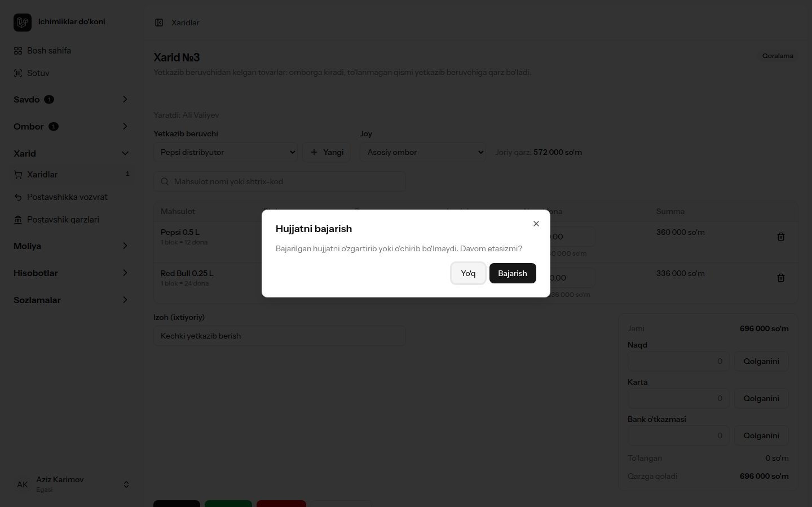

### Rule 2: A mistake is fixed with the opposite document

| Mistake in | Fix with |
| --- | --- |
| a sale | a sales return ([section 8](#8-returns)) |
| a purchase | a supplier return ([section 8](#8-returns)) |
| a transfer | **Teskari transfer** ([section 9](#9-transfer)) |
| a count | a new count ([section 10](#10-inventory-count)) |
| a cash operation | **Tuzatish** ([section 11](#11-cash-register)) |

### Rule 3: Prices are per piece

- Stock is counted in **dona** (pieces). A **blok** is a case, e.g. 1 blok = 6 dona.
- Every price you type is for **1 dona**. The block price shows under it: _1 blok = 78 000 so'm_.
- Payment methods: **Naqd** (cash), **Karta** (card), **Bank o'tkazmasi** (bank transfer).

### Who can do what

| | Owner | Employee |
| --- | --- | --- |
| Sell, transfer | yes | yes |
| Take debt payments, record expenses | yes | yes |
| Purchases, counts, sales returns | create and execute | drafts only |
| Supplier returns, opening balance, loans, write-offs, paying suppliers | yes | no |
| See costs, profit, cash balance, finance reports | yes | no |
| Manage employees, products, warehouses | yes | view products |

The left menu shows only what you may open. Typing a hidden page's address is refused too.

---

## 1. Sign up, log in, home

### Owner: create your store

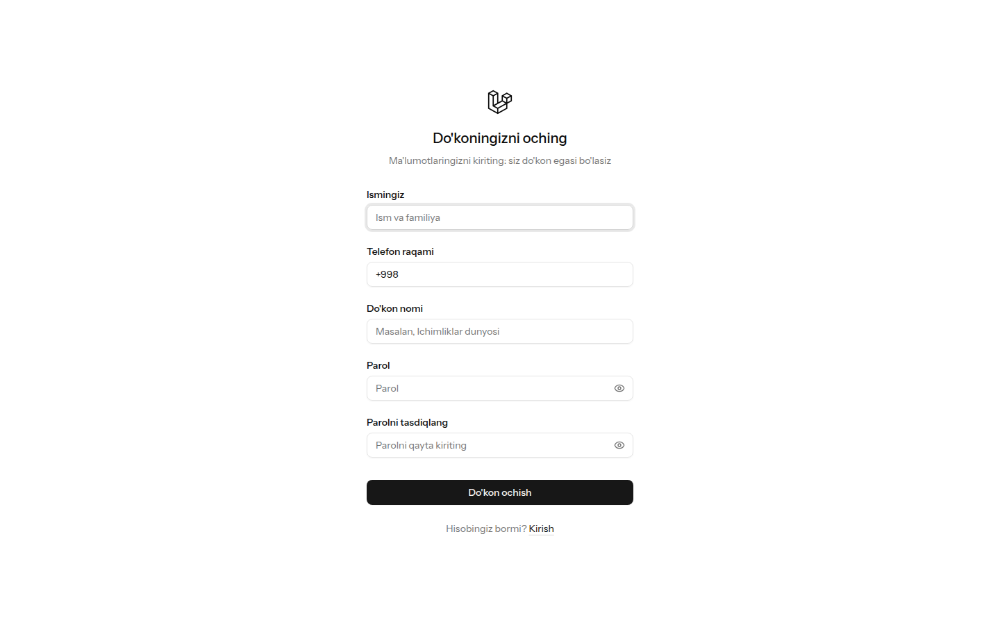

1. Click **Ro'yxatdan o'tish** (Register).
2. Fill **Ismingiz** (name), **Telefon raqami** (phone), **Parol** (password) twice, **Do'kon nomi** (store name).
3. Submit.

**Result:** you own a new store with one warehouse, **Asosiy ombor**.

### Everyone: log in

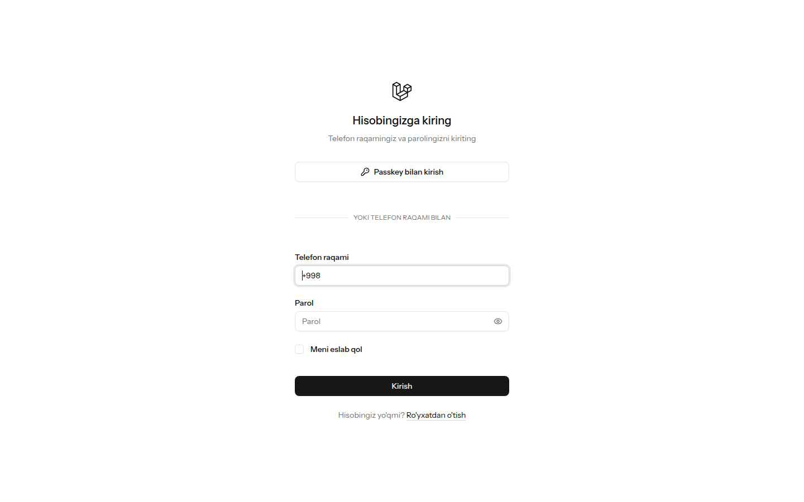

1. Enter **Telefon raqami** and **Parol**.
2. Tick **Meni eslab qol** (remember me) on your own computer.
3. Click **Kirish**.

- Forgot your password? Ask the owner. An owner asks the super-admin.
- **Do'kon bloklangan.** means the store is blocked. Data is kept.

### Owner home

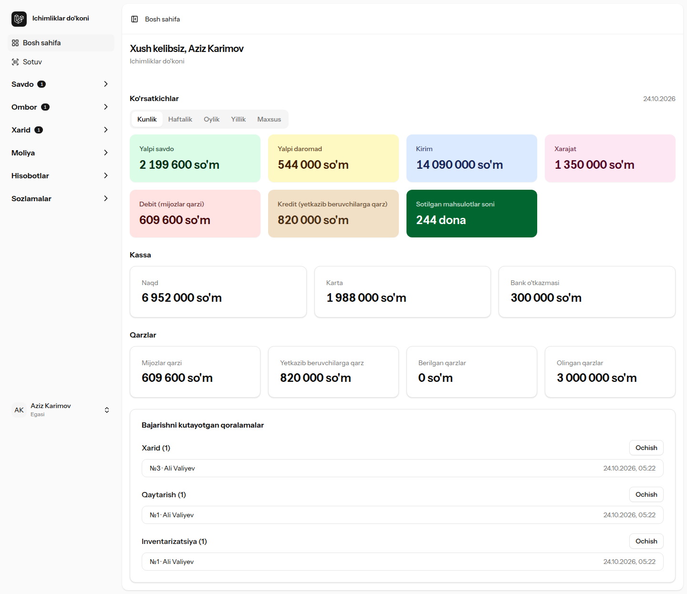

| Block | Shows |
| --- | --- |
| **Bugun** (today) | revenue, number of sales, gross profit, money received |
| **Kassa** | cash per payment method |
| **Qarzlar** | what customers owe, what you owe suppliers, loans given and taken |
| **Bajarishni kutayotgan qoralamalar** | employee drafts waiting for you. **Ochish** opens one. |

Numbers next to menu groups (**Savdo 1**, **Ombor 1**) = drafts waiting there.

### Employee home

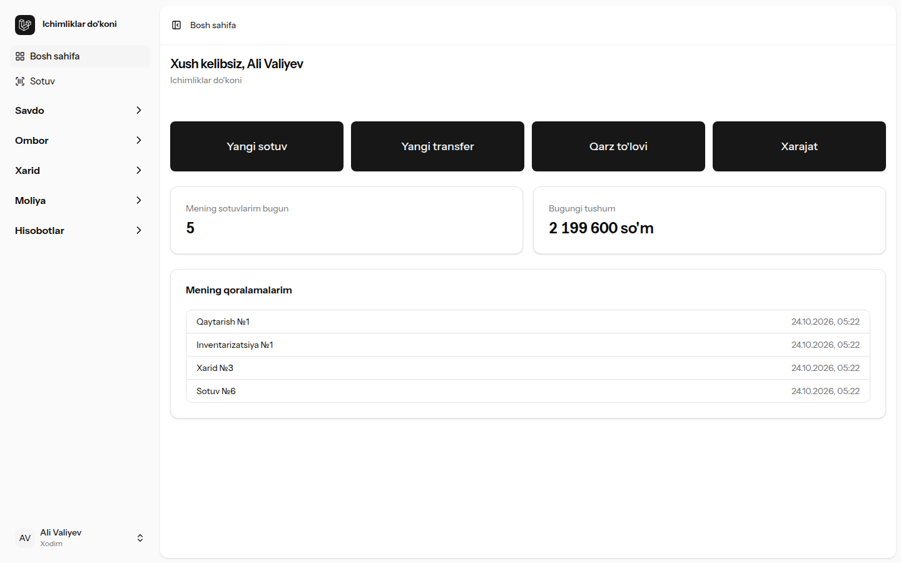

- Big buttons: **Yangi sotuv** (new sale), **Yangi transfer** (new transfer), **Qarz to'lovi** (debt payment), **Xarajat** (expense).
- **Mening qoralamalarim**: your own drafts.

---

## 2. Employees

_Owner only. Menu: **Sozlamalar → Xodimlar**._

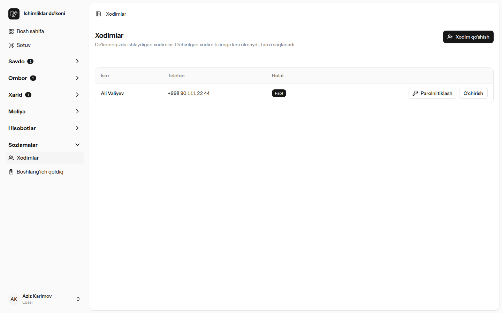

### Add an employee

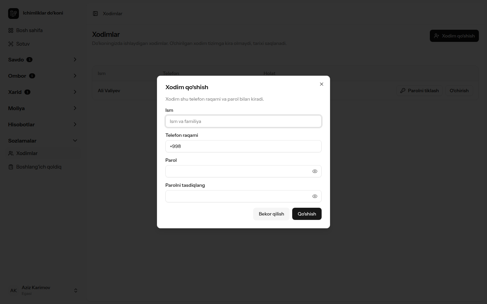

1. Click **Xodim qo'shish**.
2. Fill **Ism**, **Telefon raqami**, **Parol**, **Parolni tasdiqlang**.
3. Click **Qo'shish**.
4. Give the employee their phone and password.

**Result:** they can log in right away.

| Need | Click |
| --- | --- |
| reset a forgotten password | **Parolni tiklash** on their row |
| someone left | **O'chirish**: they're logged out; their history stays |
| let them back | **Faollashtirish** |

---

## 3. Products, warehouses, counterparties

### Products

_Menu: **Ombor → Mahsulotlar**. Owner edits; employee views._

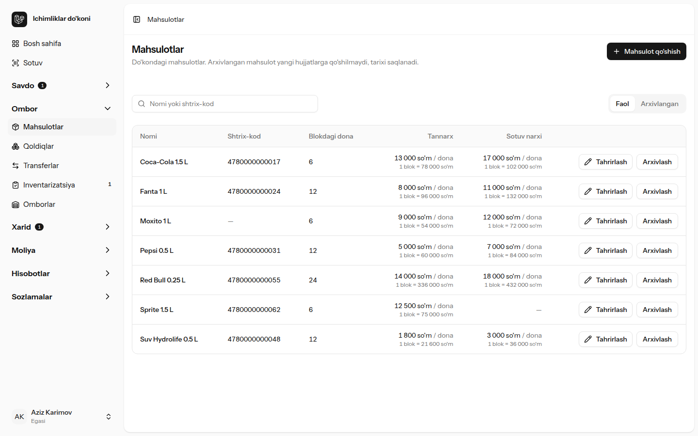

- **Tannarx** (average cost) shows to the owner only.
- **Sotuv narxi** (sale price) turns **red** when it's below cost.
- Both show the block price under them.

**Add a product:**

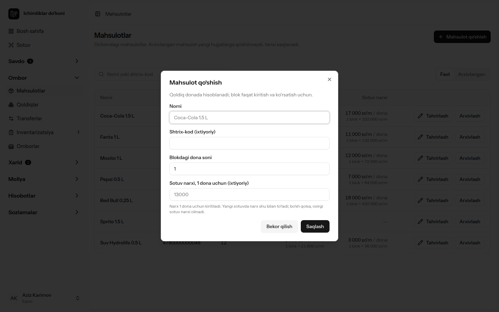

1. Click **Mahsulot qo'shish**.
2. **Nomi** (name), optional **Shtrix-kod** (barcode).
3. **Blokdagi dona soni**: pieces in one block, e.g. 6.
4. Optional **Sotuv narxi** for **1 dona**. The block price appears as you type.
5. **Saqlash**.

- Sale price empty? A new sale uses the last price this product was sold at.
- No longer sold? **Arxivlash** hides it from new documents. **Arxivdan chiqarish** brings it back.

### Warehouses

_Owner only. Menu: **Ombor → Omborlar**._

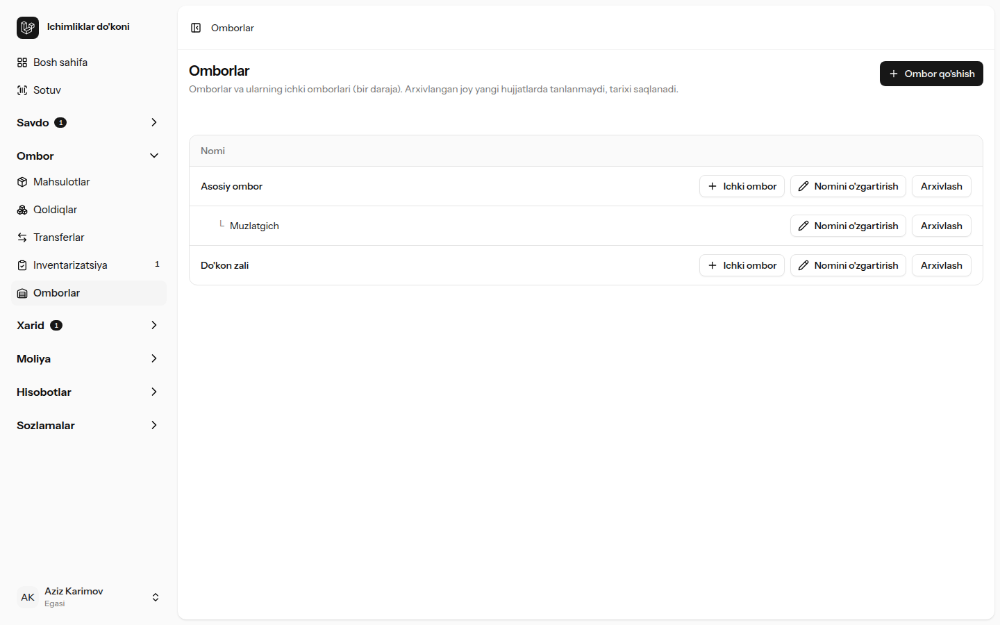

- **Ombor qo'shish**: a new warehouse.
- **Ichki ombor qo'shish**: a sub-warehouse inside one (e.g. a fridge). Its stock counts toward its warehouse.
- **Nomini o'zgartirish**: rename.

### Counterparties

_Menu: **Savdo → Kontragentlar**._

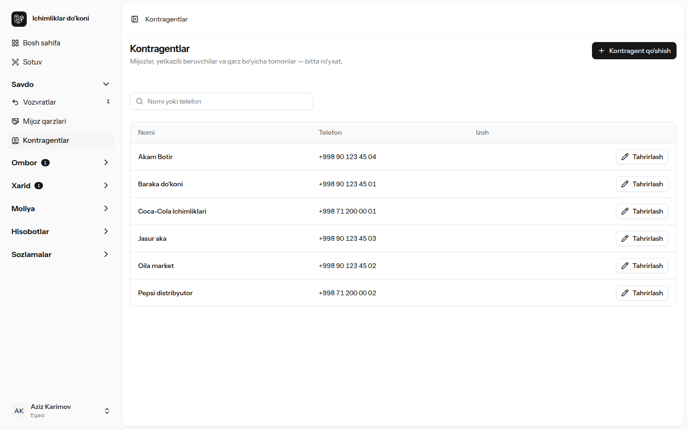

Customers, suppliers and loan parties share one list. You rarely need this page: inside a sale, purchase or loan click **+ Yangi mijoz** / **Yangi** to add one on the spot.

---

## 4. Opening balance

_Owner only, once. Menu: **Sozlamalar → Boshlang'ich qoldiq**._

What the store already had on day one. **Nothing can be executed in the store until this is done or skipped.**

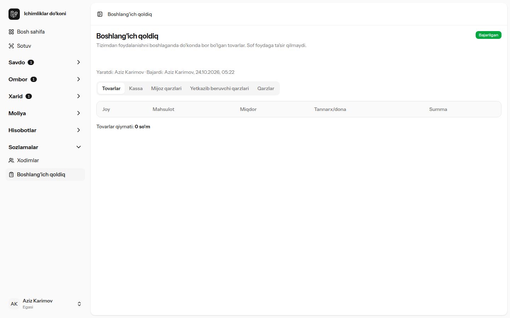

1. On the home card _Boshlang'ich qoldiqni kiriting_, click **Kiritish**.
2. Fill the tabs (save any time with **Saqlash**):
   - **Tovarlar**: product, **Joy**, **Blok** / **Dona**, **Tannarx/dona** (what 1 piece cost you)
   - **Kassa**: money now in **Naqd**, **Karta**, **Bank o'tkazmasi**
   - **Mijoz qarzlari** / **Yetkazib beruvchi qarzlari**: debts already running
   - **Qarzlar**: loans already running
3. **Bajarish** and confirm.

**Starting from zero?** Click **Boshlang'ich qoldiq yo'q** on the home card, then **Boshlang'ich qoldiqsiz ishlash**.

Never counts as profit or loss.

---

## 5. Purchase

_Menu: **Xarid → Xaridlar**._

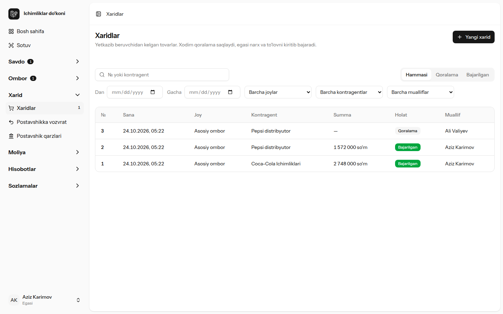

### Employee: record a delivery (no prices)

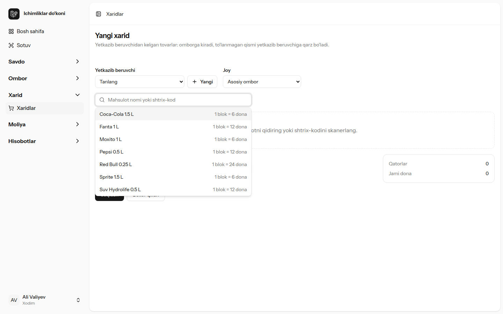

1. **Yangi xarid**.
2. Pick **Yetkazib beruvchi** (supplier) and **Joy** (where goods go).
3. Click the search box: **every product is listed**. Type to narrow, or scan a barcode.
4. Set **Blok** / **Dona** for each line.
5. **Saqlash**.

**Result:** the draft waits for the owner. **Xarid 1** appears on the owner's menu.

### Owner: price, pay, execute

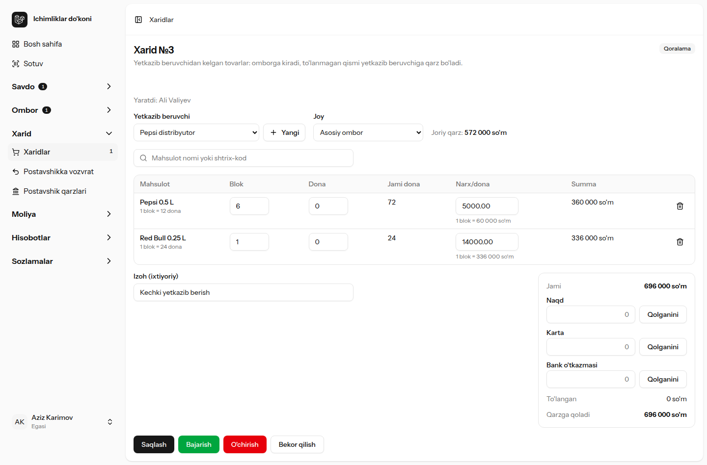

1. Open the draft from the home page or **Xaridlar**.
2. Check **Narx/dona**: pre-filled with the last purchase price. The block price shows under it.
3. Type what you paid now in **Naqd** / **Karta** / **Bank o'tkazmasi**. **Qolganini** fills the rest. The rest shows as **Qarzga qoladi** (supplier debt).
4. **Bajarish** and confirm.

**Result:**

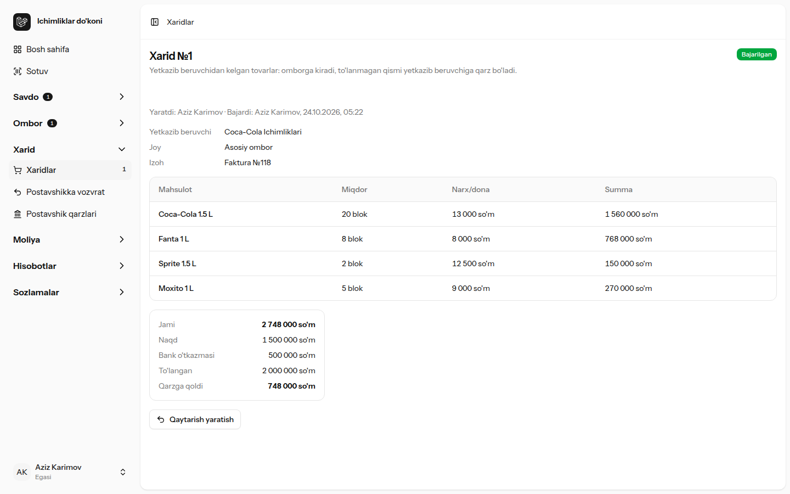

- goods are in the warehouse;
- average cost is recalculated;
- payments left the register;
- the unpaid part is now supplier debt.

| Error | Meaning |
| --- | --- |
| _Barcha narxlarni kiriting._ | a line has no price |
| _Kassada naqd yetarli emas_ | not enough cash in the register |
| red _To'lov jamidan … ko'p_ | you typed more than the total |

---

## 6. Sale

_Menu: **Sotuv** (top of the menu). Owner and employee._

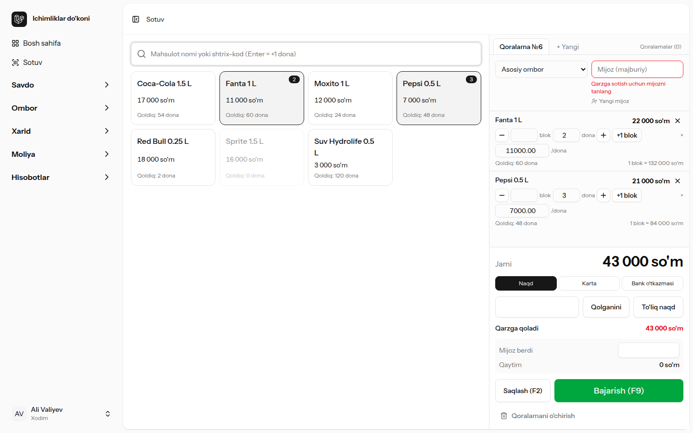

Left: product tiles and search. Right: the cart.

1. **Add products.** Scan, or type and press **Enter**: +1 dona each time. Clicking a tile does the same. **+1 blok** adds a whole block.
2. **Check the price.** Pre-filled from the product's **Sotuv narxi**, else the last sale price. Empty = _Narx yo'q_, type it.
3. **Check stock.** _Qoldiq_ under each line. Greyed tile = out of stock.
4. **Pay.** Pick a method, type the amount. **Qolganini** = the rest on this method. **To'liq naqd** = all in cash.
5. **Bajarish (F9)**.

Searching narrows the tiles:

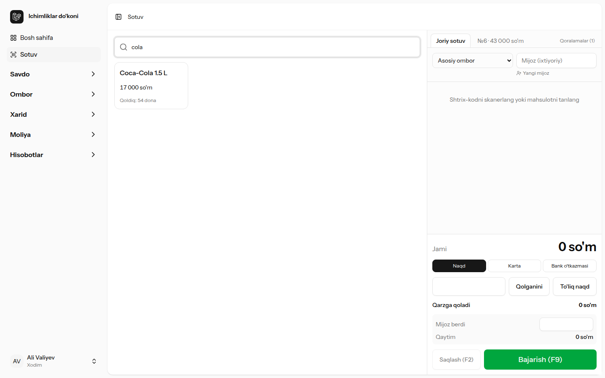

### Selling on debt

- The unpaid part shows live as **Qarzga qoladi**.
- Then the customer is required: **Mijoz (majburiy)**. Pick one or click **Yangi mijoz**.

### Change helper

Type **Mijoz berdi** (cash handed over) to see **Qaytim** (change). Not saved.

### Park a sale

**Saqlash (F2)** parks it as a draft and clears the screen. Parked sales: **Qoralamalar (N)** at the top of the cart.

### The receipt

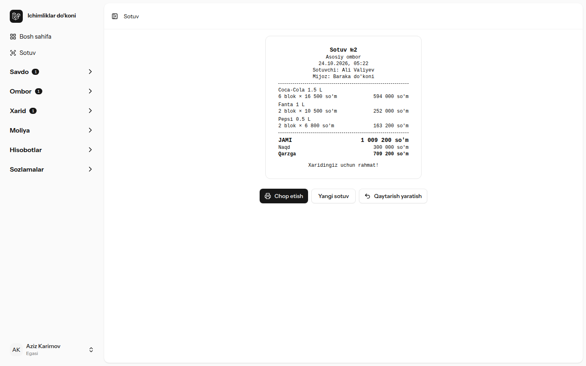

- **Chop etish**: print.
- **Yangi sotuv**: next customer.
- **Qaytarish yaratish**: start a return for this sale.

Two people can't sell the same last bottle: the second sale is refused.

---

## 7. Debts

### Customer debts

_Menu: **Savdo → Mijoz qarzlari**. Owner and employee._

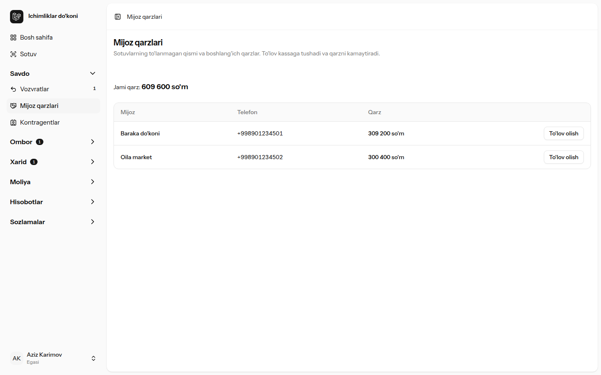

Click a customer to open their card:

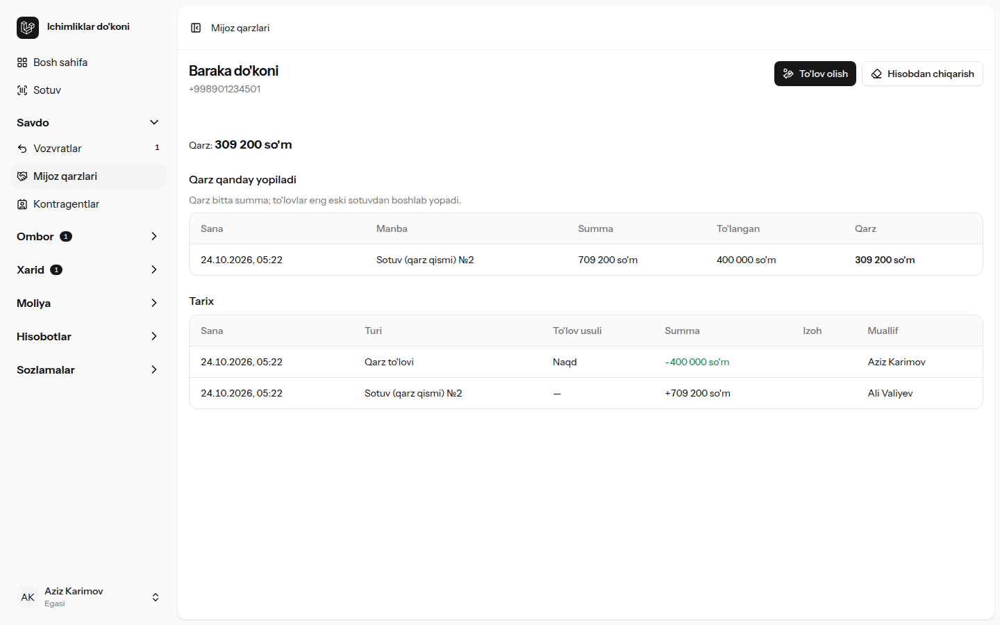

- **Qarz qanday yopiladi**: which sales are still unpaid. Payments always pay off the **oldest sale first**.
- **Tarix**: every sale, payment, return and write-off.

**Take a payment:**

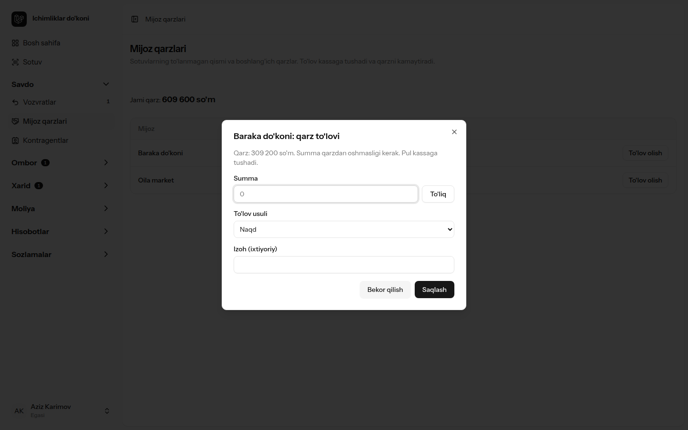

1. **To'lov olish** (on the list row or the card).
2. **Summa**, or **To'liq** for the whole debt.
3. **To'lov usuli**, then save.

A payment can't exceed the debt.

**Write off a bad debt** (owner only): **Hisobdan chiqarish** on the card. The debt goes down, no money moves, it shows as _Umidsiz qarz_ in profit and loss.

### Supplier debts

_Owner only. Menu: **Xarid → Postavshik qarzlari**._

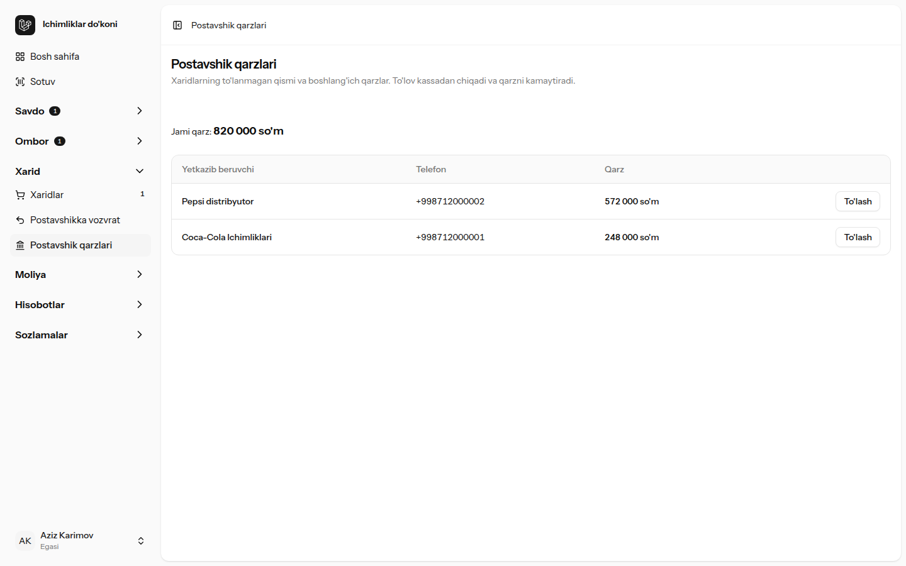

1. **To'lash** on the supplier's row.
2. Amount and method, then save.

You can't pay more than you owe, or more than the register holds.

---

## 8. Returns

### Customer brings goods back (Vozvrat)

_Menu: **Savdo → Vozvratlar**. Employee drafts, owner executes._

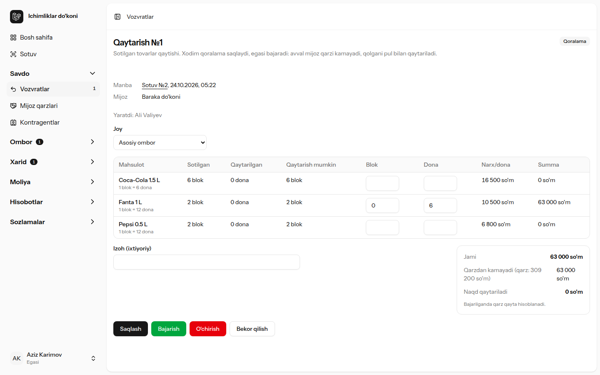

1. On the sale receipt click **Qaytarish yaratish**. Or **Vozvratlar → Yangi qaytarish** and pick the sale.
2. Each line shows **Sotilgan / Qaytarilgan / Qaytarish mumkin** (sold / returned / can return). Type **Blok** / **Dona** coming back.
3. Pick **Joy** (where goods go back).
4. **Saqlash**. The owner opens it and clicks **Bajarish**.

**Result:** the customer's debt goes down **first** (**Qarzdan kamayadi**). Only the rest is paid back (**Naqd qaytariladi**).

### You send goods back to a supplier

_Owner only. Menu: **Xarid → Postavshikka vozvrat**._

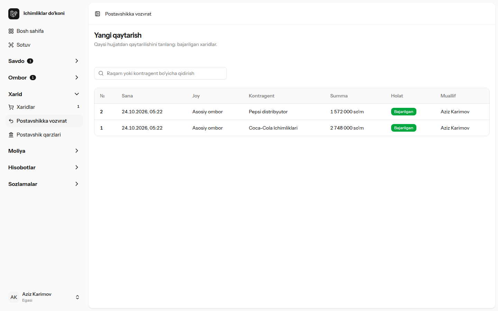

1. Pick the executed purchase (or **Qaytarish yaratish** on it).
2. Type what goes back.
3. **Bajarish**.

**Result:** your debt to the supplier goes down first; the rest comes back into the register.

---

## 9. Transfer

_Menu: **Ombor → Transferlar**. Owner and employee._

Moves goods between places, e.g. warehouse → shop floor. Money doesn't change.

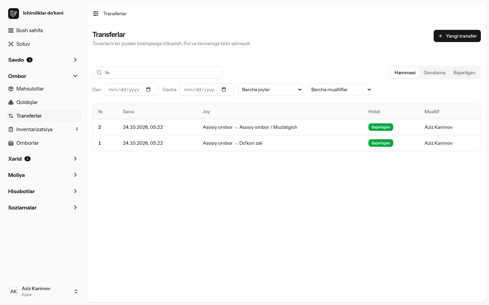

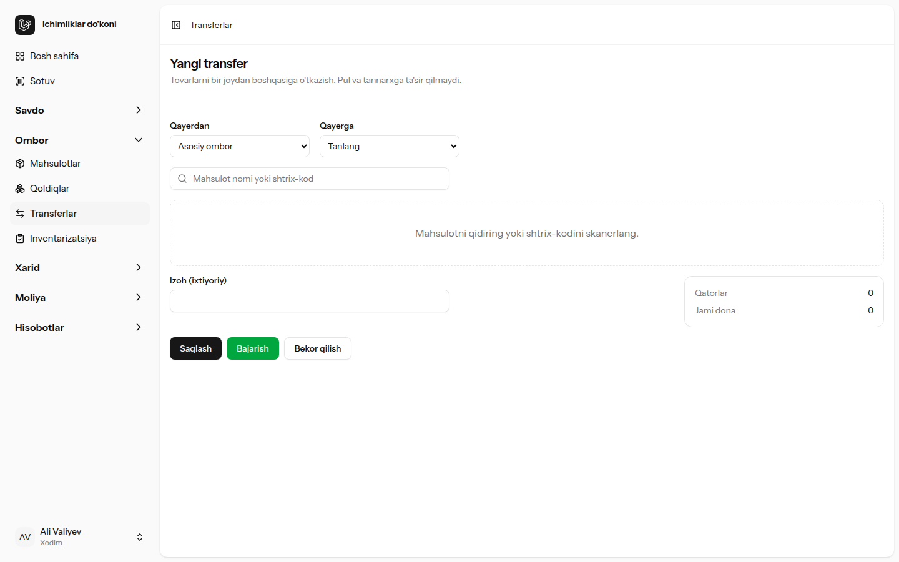

1. **Yangi transfer**.
2. **Qayerdan** (from) and **Qayerga** (to). They must differ.
3. Add products, **Blok** / **Dona**.
4. **Bajarish** (or **Saqlash** for later).

**Made a mistake?** Open the executed transfer:

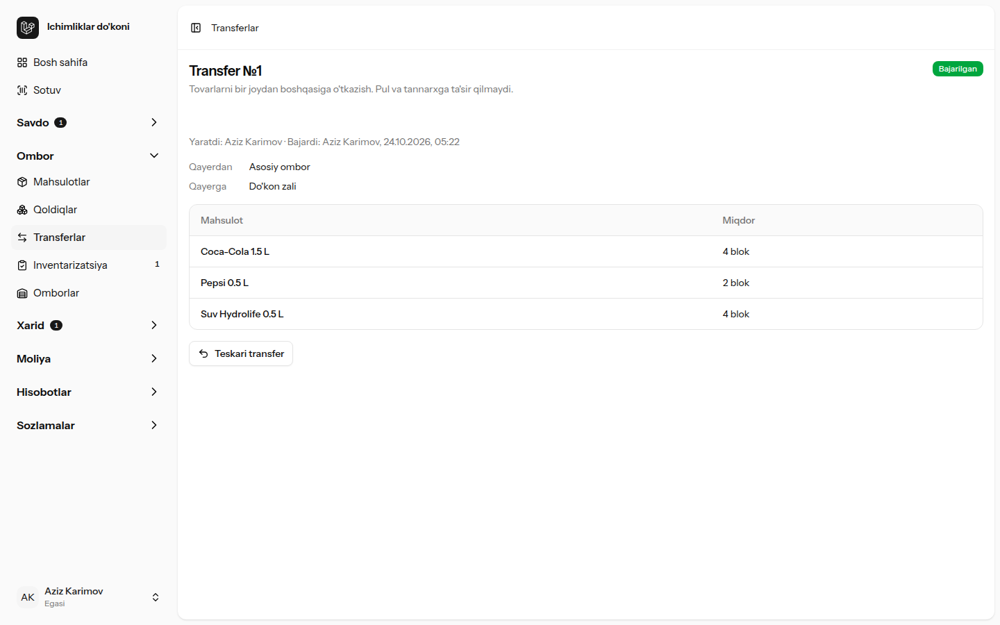

Click **Teskari transfer**: a new draft with the places swapped. Execute it.

---

## 10. Inventory count

_Menu: **Ombor → Inventarizatsiya**. Employee counts, owner executes._

### Employee: count

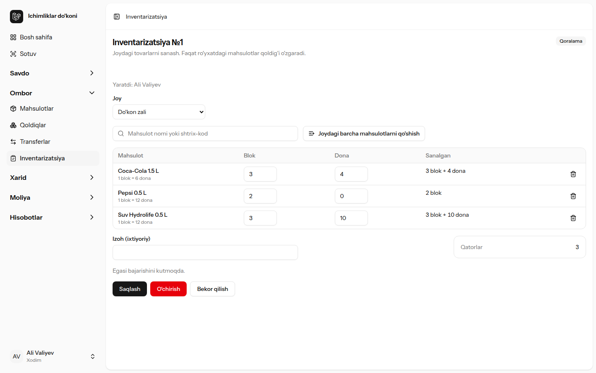

1. **Yangi inventarizatsiya**, pick **Joy**.
2. Add products one by one, or **Joydagi barcha mahsulotlarni qo'shish** for everything there.
3. Type what you **see** as **Blok** / **Dona**. You don't see the expected number, so count honestly.
4. **Saqlash** as often as you like.

### Owner: review and execute

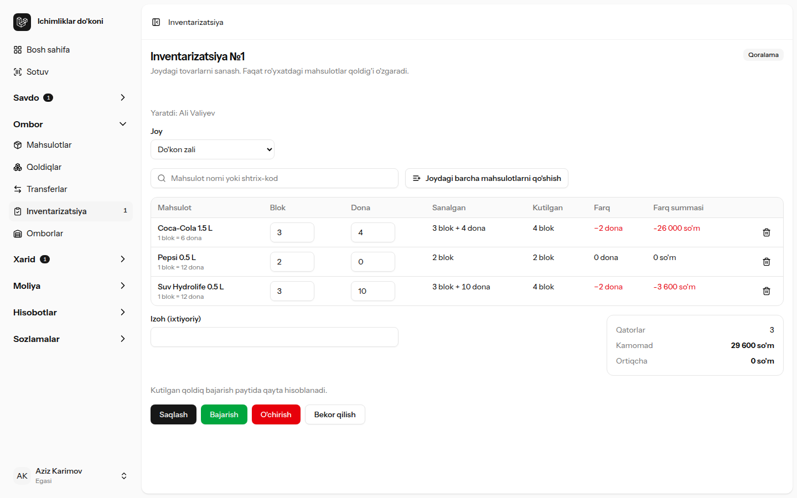

| Column | Meaning |
| --- | --- |
| **Sanalgan** | counted |
| **Kutilgan** | what the system expected |
| **Farq** | difference (red = missing) |
| **Farq summasi** | difference in money, at average cost |

Click **Bajarish**.

**Result:** stock of each listed product = counted. Unlisted products don't change. Shortage = loss, surplus = gain in **Foyda va zarar**. "Expected" is recalculated at execution, so sales during the count don't show as false shortages.

---

## 11. Cash register

_Menu: **Moliya → Kassa**._

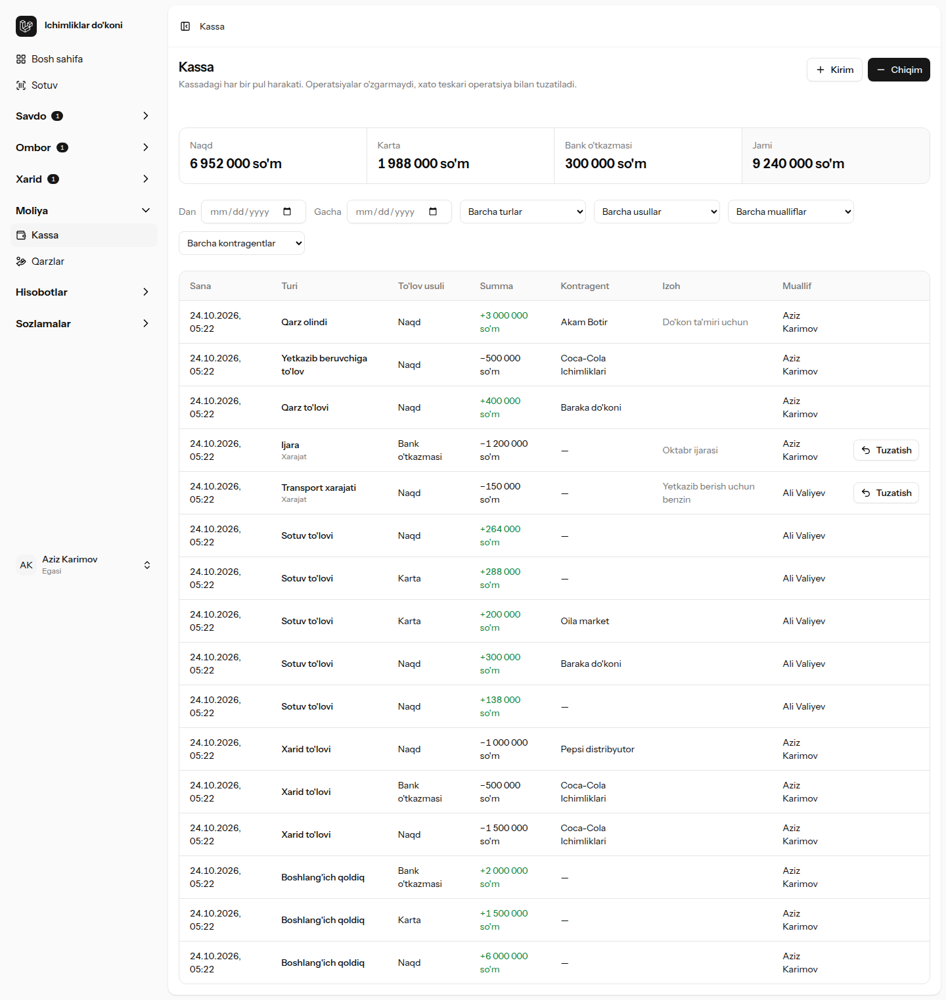

- Every money movement in the store. Sales, purchases, debts and loans add theirs automatically.
- The balance strip on top (**Naqd | Karta | Bank o'tkazmasi | Jami**) shows to the owner only.

### Money in: Kirim

1. **Kirim**.
2. Pick the type: _Mijoz qarzi to'lovi_ (customer pays debt) or, owner only, _Olingan foiz_ (interest received).
3. **Summa**, **To'lov usuli**, optional **Izoh**, **Saqlash**.

### Money out: Chiqim

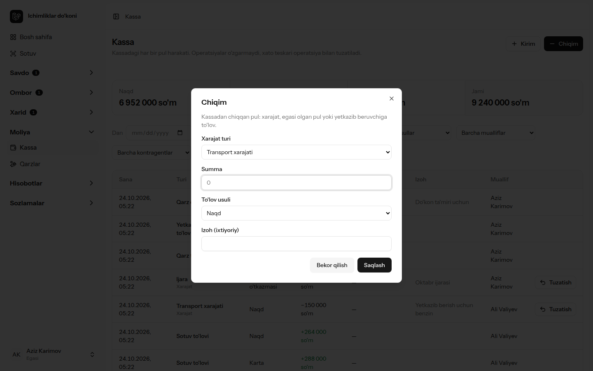

1. **Chiqim**.
2. Pick **Xarajat turi** (expense type, table below).
3. **Summa**, **To'lov usuli**, **Izoh**, **Saqlash**.

| Xarajat turi | Meaning | In profit | Employee may use |
| --- | --- | --- | --- |
| Transport xarajati | delivery, fuel | yes | yes |
| Ijara | rent | yes | yes |
| Ish haqi | salaries | yes | yes |
| Kommunal | utilities | yes | yes |
| Soliq | taxes | yes | yes |
| Boshqa | other (**note required**) | yes | yes |
| Qarz foizi | loan interest you paid | yes | no |
| Egasi olgan pul | owner takes money for themselves | **no** | no |

You can't take out more than the register holds in that method.

### Fix a mistake: Tuzatish

Owner only. **Tuzatish** on the row records the opposite operation. Each operation can be fixed once.

---

## 12. Loans

_Owner only. Menu: **Moliya → Qarzlar**._

Money lent or borrowed outside sales, e.g. from a relative.

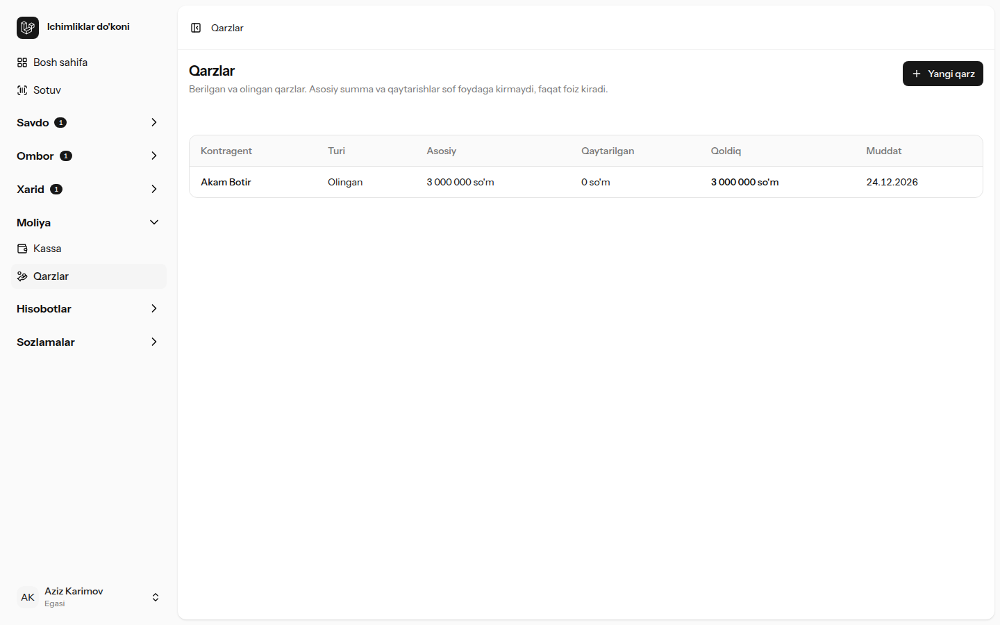

**Create a loan:**

1. **Yangi qarz**.
2. **Turi**: **Berilgan** (you lent) or **Olingan** (you borrowed).
3. **Kontragent**, **Asosiy summa** (principal), **To'lov usuli**.
4. Optional **Qaytarish muddati** (due date) and note. Save.

**Result:** the money leaves the register (lent) or enters it (borrowed). Overdue loans show in red.

**On the loan card:**

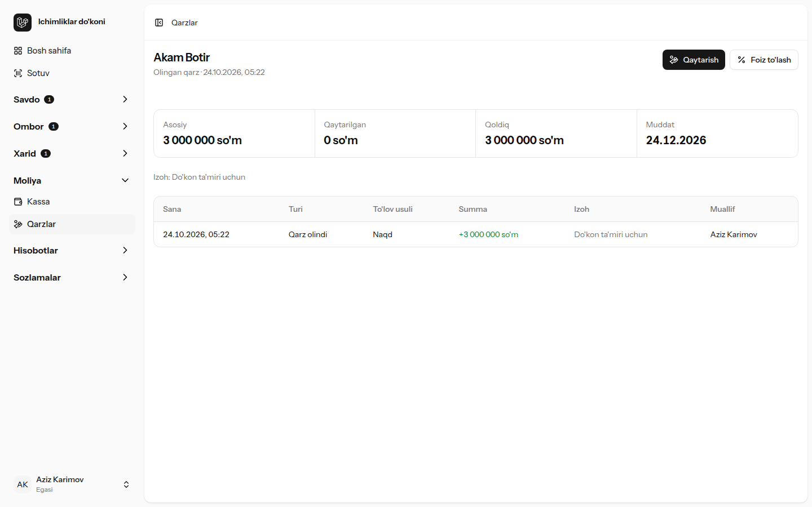

- **Qaytarish**: a repayment, up to what's still owed.
- **Foiz to'lash** / **Foiz olish**: interest paid or received.

The loan amount is never profit or loss. Only interest is.

---

## 13. Reports

_Menu: **Hisobotlar**, and **Ombor → Qoldiqlar** for stock._

### Qoldiqlar (stock): owner and employee

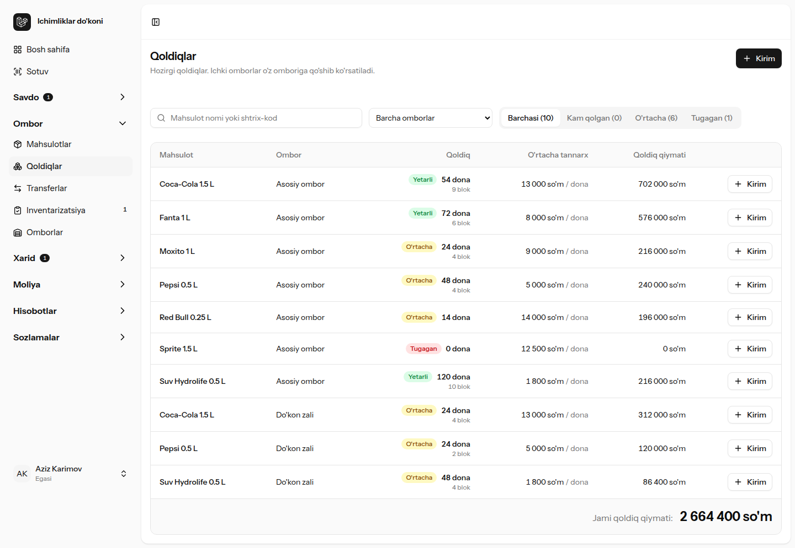

- **Qoldiq**: pieces first, blocks under in grey.
- Tabs by level: **Kam qolgan** (1–10 dona), **O'rtacha** (11–50, yellow), **Tugagan** (0, red). Green = **Yetarli**.
- Filter by **Ombor**. A warehouse includes its sub-warehouses.
- Owner also sees **O'rtacha tannarx** and **Qoldiq qiymati**, with the total at the bottom.

### Sotuvlar (sales): owner and employee

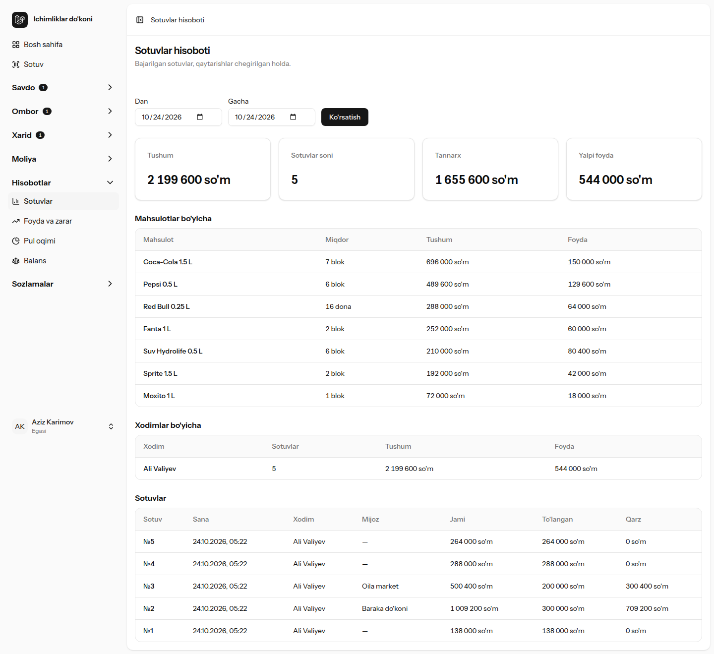

Revenue (returns subtracted), number of sales, by product, by employee, paid vs debt. Cost and gross profit: owner only.

### Foyda va zarar (profit and loss): owner

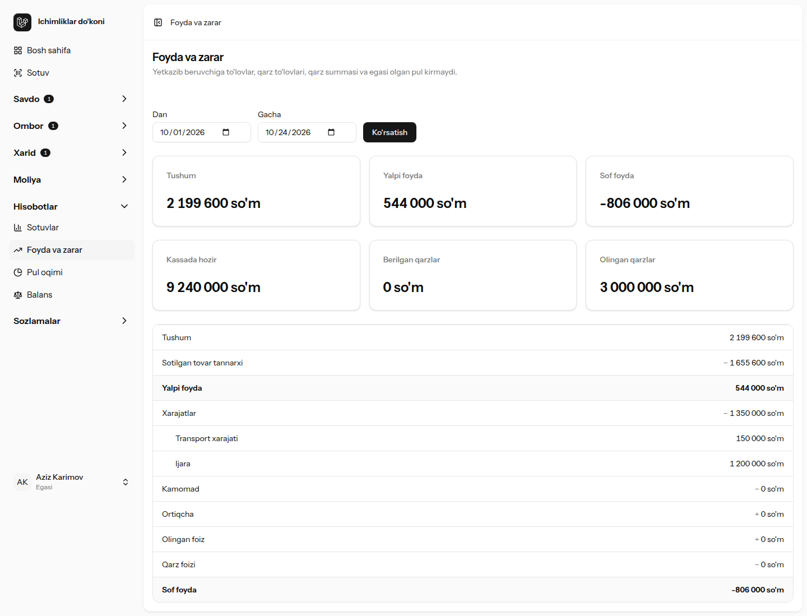

```
  Tushum                      revenue
− Sotilgan tovar tannarxi     cost of goods sold
= Yalpi foyda                 gross profit
− Xarajatlar                  expenses that count in profit
− Kamomad  + Ortiqcha         count shortages and surpluses
± Qarz foizi / Olingan foiz   loan interest
= Sof foyda                   net profit
```

Not included: supplier payments, debt payments, loan principal, _Egasi olgan pul_, opening balance. Cash now and loans show next to net profit.

### Pul oqimi (cash flow): owner

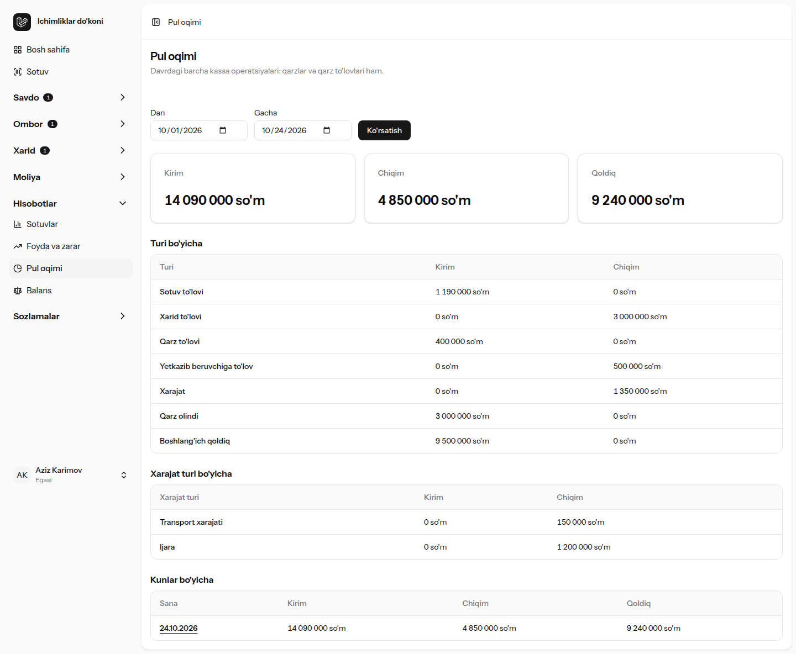

Money in, out and net, by type and by day. Click a day to open Kassa for that day.

### Balans: owner

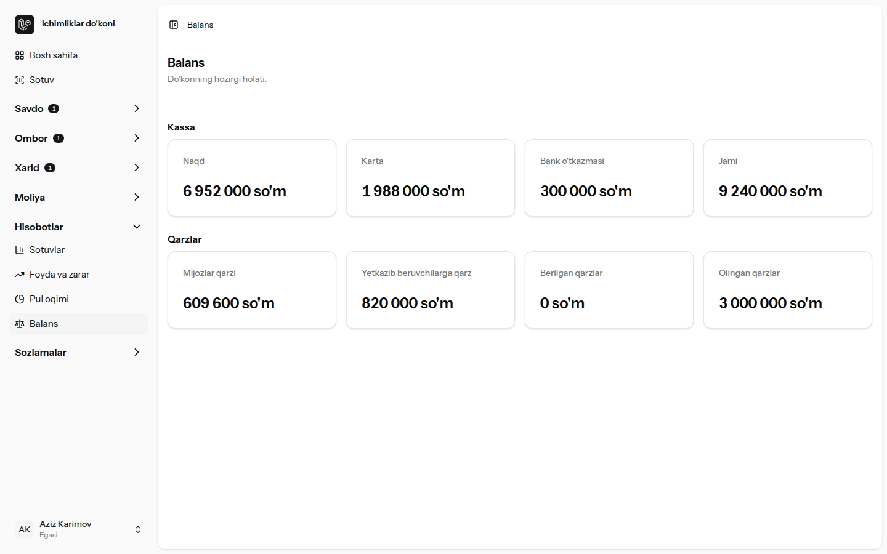

Right now: cash per method, loans given and taken, what customers owe you, what you owe suppliers.

---

## 14. Settings and super-admin

### Your account

Click your name at the bottom of the menu.

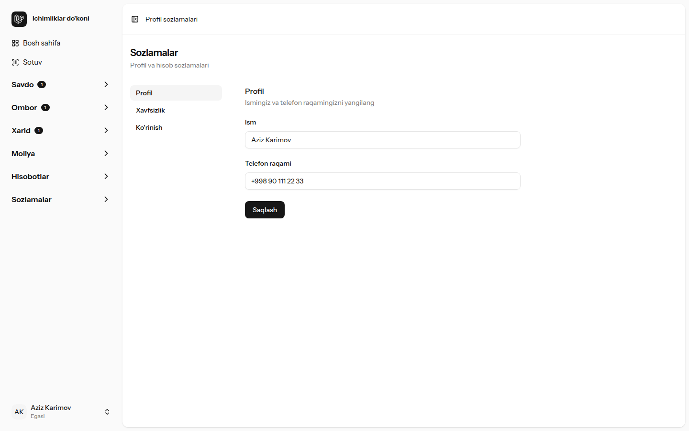

- **Profil**: name and phone.
- **Xavfsizlik**: change password; optional two-factor login or passkey.
- **Ko'rinish**: light or dark theme.

### Super-admin

Runs the platform, not a store. Created only on the server:

```bash
php artisan app:create-super-admin --name="Admin" --phone="+998901234567" --password="secret-password"
```

Menu: **Platforma → Do'konlar**.

- **Bloklash** / **Blokdan chiqarish**: block or unblock a store. Its users are logged out. Nothing is deleted.
- **Egasining parolini tiklash**: new password for a locked-out owner.

The super-admin can't open any store's products, documents, cash or reports.
